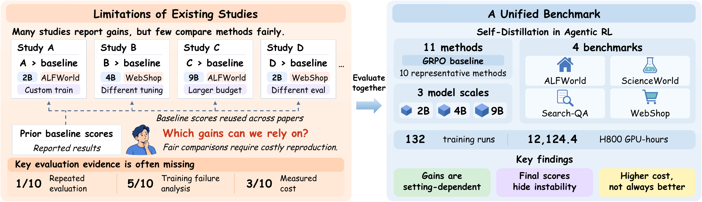

<div align="center">

# More Methods, Better Agents? A Reality Check on Self-Distillation in Agentic Reinforcement Learning

[](https://arxiv.org/abs/2610.19789) [](https://aim-uofa.github.io/Self-Distillation-AgentRL) [](https://github.com/aim-uofa/Self-Distillation-AgentRL)

</div>

**Self-Distillation-AgentRL** is the official codebase for our study of self-distillation in agentic reinforcement learning.

## Overview

Do more self-distillation methods lead to better agents? We compare ten representative approaches against GRPO across four benchmarks and three model sizes, using shared environments and evaluation procedures while retaining method-specific training settings. Beyond final task performance, we examine training progress, stability, and measured computational cost.



**Study overview.** From fragmented evidence to a common benchmark for assessing the breadth of gains, training stability, and computational cost.

Our evaluation yields three main findings:

- **Gains remain setting-dependent.** No method consistently outperforms GRPO across settings.
- **Strong final performance does not imply stable training.** Final scores can conceal instability along the training trajectory.
- **More computation does not consistently yield better agents.** Additional training cost does not reliably translate into improved performance.

This repository provides a common framework for training, checkpoint conversion, and evaluation, supporting direct comparisons and further research on reliable, cost-effective agent training.

## Benchmark Coverage

The study spans **12 model–task settings** and **132 training runs**, with repeated evaluations over **eight rollout seeds** for pretrained and trained models.

### Supported Models

- ✅ Qwen3.5-2B (`MODEL_SIZE=2B`)
- ✅ Qwen3.5-4B (`MODEL_SIZE=4B`)
- ✅ Qwen3.5-9B (`MODEL_SIZE=9B`)

### Supported Benchmarks

- ✅ ALFWorld (`TASK=alfworld`)
- ✅ ScienceWorld (`TASK=scienceworld`)
- ✅ Search-QA (`TASK=search`)
- ✅ WebShop (`TASK=webshop`)

### Supported Methods

- ✅ GRPO — baseline (`METHOD=grpo`)
- ✅ GRPO+OPSD (`METHOD=grpo_opsd`)
- ✅ SDAR (`METHOD=sdar`)
- ✅ Skill-SD (`METHOD=skillsd`)
- ✅ RLSD (`METHOD=rlsd`)
- ✅ OCSD (`METHOD=ocsd`)
- ✅ OVCSD (`METHOD=ovcsd`)
- ✅ AgentOPSD (`METHOD=agentopsd`)
- ✅ ADRS (`METHOD=adrs`)
- ✅ ICSD (`METHOD=icsd`)
- ✅ PCSD (`METHOD=pcsd`)

The launchers support training-time validation, standalone evaluation, rollout recording, benchmark mean/standard deviation, and pass@k.

## Getting Started

All entry points are in [launchers/](launchers/). The workflow below covers environment setup, data preparation, training, checkpoint conversion, and evaluation.

### 1. Environment Setup

Use Linux x86_64 with Conda, NVIDIA GPUs, and a compatible CUDA toolchain/C++ compiler. Run all commands in Bash from the repository root.

```bash
chmod +x launchers/*.sh
export PROJECT_ROOT="$(dirname "$PWD")"
export CONDA_ENV=agentrl
export DATA_ROOT="$PROJECT_ROOT/data"
export HF_HOME="$PROJECT_ROOT/hf_cache"
export VERL_AUTO_PADDING=1

bash launchers/setup_env.sh
source launchers/conda.sh
agentrl_activate_conda
```

The installer creates the environment, installs the local packages and pinned dependencies, and applies the bundled decord/TextWorld compatibility wheels automatically. Dependency specifications are in [requirements.txt](requirements.txt), [requirements-kernels.txt](requirements-kernels.txt), and [constraints.txt](constraints.txt).

Choose an unused `CONDA_ENV`; use `REUSE_ENV=1` only to resume an interrupted installation. If Conda is not detected, set `CONDA_BASE` to its installation directory. In new terminals, repeat the exports and activation commands, not the installation. Models, data, logs, and checkpoints default to `$PROJECT_ROOT`.

### 2. Models and Data

Choose `2B`, `4B`, or `9B` for `MODEL_SIZE` and download the corresponding model:

```bash
export MODEL_SIZE=2B
export MODEL_PATH="$PROJECT_ROOT/models/Qwen3.5-${MODEL_SIZE}"
MODEL_ID="Qwen/Qwen3.5-${MODEL_SIZE}" bash launchers/prepare_model.sh
```

For an existing local model, set `MODEL_SIZE` and `MODEL_PATH` and skip the download. Interrupted downloads resume with the same command. When switching models, update these variables and regenerate `EXPERIMENT_NAME` below.

Prepare only the benchmarks you need:

```bash
bash launchers/prepare_alfworld.sh
bash launchers/prepare_webshop.sh small
bash launchers/prepare_search.sh qa
bash launchers/prepare_search.sh retrieval
bash launchers/install_scienceworld.sh
bash launchers/prepare_scienceworld.sh
```

For Search-QA, start the retrieval service in a second terminal with the same environment and path exports:

```bash
GPU_ID=0,1,2,3,4,5,6,7 PORT=19080 FAISS_GPU=1 \
  bash launchers/start_search_retriever.sh
```

This shards the FAISS index across GPUs 0–7 in FP16 and runs the E5 encoder on GPU 0. Keep the service running and reserve memory for it when sharing GPUs with training or evaluation.

In each training/evaluation terminal, set the retrieval endpoint:

```bash
export SEARCH_URL=http://127.0.0.1:19080/retrieve
```

Update `SEARCH_URL` if you change the service host or port.

### 3. Training

Choose `METHOD` and `TASK` from the identifiers in [Benchmark Coverage](#benchmark-coverage). The same command works across the supported models, methods, and benchmarks; `PAPER_CONFIG=1` selects the study-oriented launcher defaults.

```bash
export METHOD=grpo TASK=alfworld
export EXPERIMENT_NAME="${METHOD}_qwen35_${MODEL_SIZE,,}_${TASK}_8gpu"

GPU_ID=0,1,2,3,4,5,6,7 PAPER_CONFIG=1 \
TOTAL_TRAINING_STEPS=100 TEST_FREQ=5 \
SAVE_FREQ=20 MAX_ACTOR_CKPTS=5 RESUME_MODE=disable \
bash "launchers/train_${METHOD}_${TASK}.sh" \
  trainer.n_gpus_per_node=8 ray_init.num_cpus=64 \
  actor_rollout_ref.rollout.enable_chunked_prefill=True \
  actor_rollout_ref.rollout.enforce_eager=False \
  +actor_rollout_ref.rollout.engine_kwargs.vllm.gdn_prefill_backend=triton
```

Keep `GPU_ID` and `trainer.n_gpus_per_node` consistent; for one GPU, use `GPU_ID=0` and `trainer.n_gpus_per_node=1`. To resume training, keep the original experiment name and set `RESUME_MODE=auto`.

With `PAPER_CONFIG=1`, rollout GPU memory utilization defaults to 0.30 for 2B/4B training, 0.65 for 9B training (including validation), and 0.30 for standalone evaluation. Model size is selected by `MODEL_SIZE`, or the standard model directory name when unset. Override with `GPU_MEMORY_UTILIZATION` if needed.

### 4. Checkpoint Conversion

Convert a saved checkpoint to Hugging Face format before evaluation. Change `global_step_100` to select a different training step.

```bash
CHECKPOINT_TASK="$TASK"
if [[ "$TASK" == search ]]; then CHECKPOINT_TASK=searchQA; fi
STEP_DIR="$PROJECT_ROOT/checkpoints/$METHOD/$CHECKPOINT_TASK/$EXPERIMENT_NAME/global_step_100"
bash "launchers/merge_${METHOD}_checkpoint.sh" "$STEP_DIR"
export MERGED_MODEL="$STEP_DIR/merged_hf"
```

Allow enough CPU RAM and disk space for merging; evaluation uses `merged_hf/`, not the raw `actor/` shards.

### 5. Evaluation

To evaluate pretrained weights, complete steps 1–2 and select a benchmark, for example `export TASK=alfworld`. To evaluate a trained checkpoint, first convert it as described above.

#### Single Evaluation

```bash
PAPER_CONFIG=1 GPU_ID=0 EVAL_DO_SAMPLE=true EVAL_TEMPERATURE=0.4 \
bash "launchers/test_pretrained_${TASK}.sh" \
  ray_init.num_cpus=64 \
  +actor_rollout_ref.actor.fsdp_config.model_dtype=bfloat16 \
  actor_rollout_ref.rollout.enable_chunked_prefill=True \
  +actor_rollout_ref.rollout.engine_kwargs.vllm.gdn_prefill_backend=triton
```

To evaluate a trained model, use `bash "launchers/test_${METHOD}_${TASK}.sh" "$MERGED_MODEL"` in place of the pretrained script, keeping the same environment variables and overrides.

#### Multiple Seeds and Pass@k

```bash
PAPER_CONFIG=1 MODEL_KIND=pretrained GPU_IDS=0,1,2,3,4,5,6,7 \
MAX_PASS_K=8 TEMPERATURE=0.4 \
RUN_ID=eval_run_01 \
bash launchers/eval_pass_at_k.sh
```

For a merged checkpoint from any method, replace `MODEL_KIND=pretrained` with `MODEL_KIND=grpo GRPO_MODEL_PATH="$MERGED_MODEL" MODEL_TAG="${EXPERIMENT_NAME}_step100"`. Here `grpo` names the shared checkpoint-loading route, not the training method; adjust the tag to match the checkpoint step.

With `MAX_PASS_K=8`, seeds default to 0–7, with one seed per GPU.

Logs are saved under `$PROJECT_ROOT/logs/`. Repeated evaluation also saves rollouts, benchmark mean/standard deviation, and pass@k under `logs/pass_at_k/`.

## Acknowledgments

Our implementation builds on [SDAR](https://github.com/ZJU-REAL/SDAR), [veRL](https://github.com/volcengine/verl), and [verl-agent](https://github.com/langfengQ/verl-agent). We thank the authors and contributors of these projects and the benchmark environments for their open-source work.

## 🖊️ Citation

If you find this work useful, please consider citing:

```bibtex
@misc{zhong2026methodsbetteragentsreality,
    title={More Methods, Better Agents? A Reality Check on Self-Distillation in Agentic Reinforcement Learning},
    author={Linhao Zhong and Bozhen Fang and Xuehao Wang and Duochao Shi and Zekai Luo and Guangming Yao and Yi Yuan and Hao Chen and Jingdong Chen and Chunhua Shen},
    year={2026},
    eprint={2610.19789},
    archivePrefix={arXiv},
    primaryClass={cs.CL},
    url={https://arxiv.org/abs/2610.19789},
}
```
